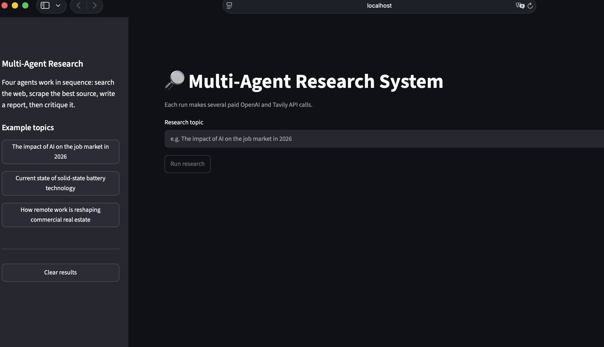
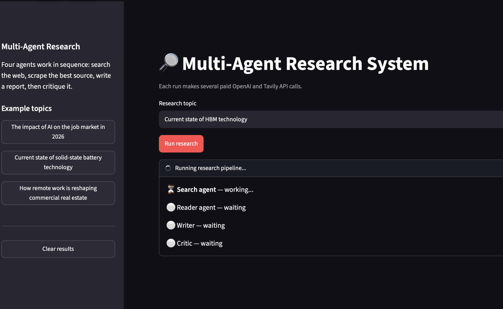
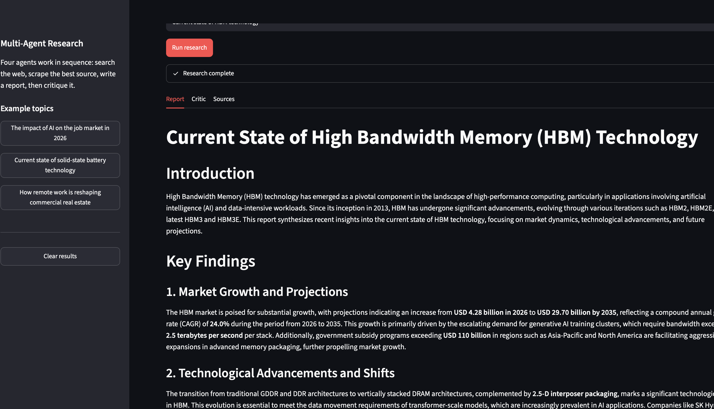
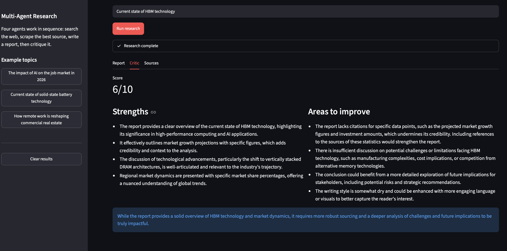
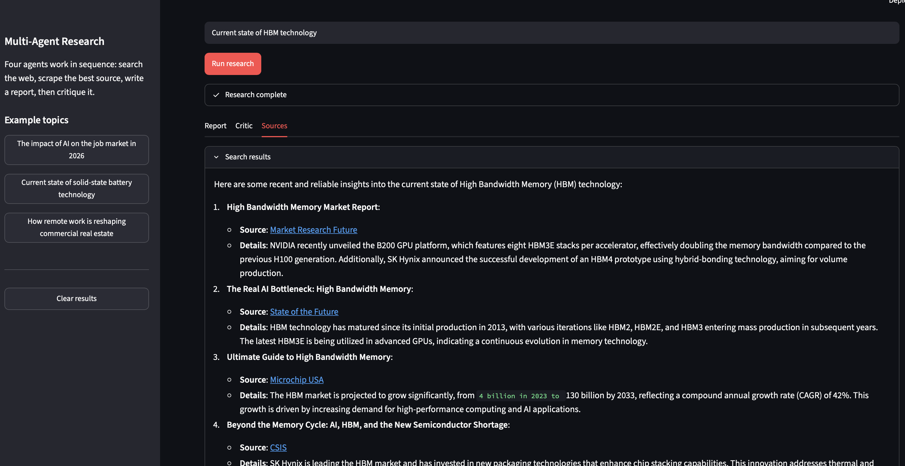

# LangChain Multi-Agent Research System

A research assistant built from four cooperating LLM steps. Give it a topic and it searches the web, scrapes the best source, writes a structured report, and then has a critic review that report. It runs from a Streamlit UI or from the command line.

## Demo

Example topic: *"Current state of HBM technology"*.

**1. Start screen** — enter a topic or pick an example from the sidebar.



**2. Live progress** — each agent shows waiting, working, or done while the pipeline runs.



**3. Report** — the writer's structured report (Introduction, Key Findings, Conclusion, Sources), downloadable as Markdown.



**4. Critic** — the critic's score, strengths, areas to improve, and one-line verdict.



**5. Sources** — the raw search results and scraped content behind the report.



## How it works

```
topic ─► Search agent ─► Reader agent ─► Writer chain ─► Critic chain ─► report + feedback
         (web_search)    (scrape_url)    (LCEL)          (LCEL)
```

| Step | Type | Job |
|------|------|-----|
| 1. Search | Agent with the `web_search` tool (Tavily) | Finds recent sources: titles, URLs, snippets |
| 2. Read | Agent with the `scrape_url` tool | Picks the most relevant URL and extracts its content |
| 3. Write | LCEL prompt chain | Drafts a report from the search results and scraped content |
| 4. Critique | LCEL prompt chain | Scores the report out of 10 and lists strengths and improvements |

The pipeline returns a dict with `search_result`, `scraped_content`, `report` and `feedback`.

### Why multiple agents?

A single agent that searches, scrapes, writes, and reviews its own work has to carry every tool, instruction, and intermediate result in one context. Splitting the work gives each step a narrow prompt and only the tools it needs. It also lets a separate critic judge the report instead of the writer grading itself.

## Tech stack

- [LangChain](https://python.langchain.com/) for agents and LCEL chains, with `gpt-4o-mini` via `langchain-openai`
- [Tavily](https://tavily.com/) for web search
- trafilatura, readability-lxml and BeautifulSoup for page extraction
- [Streamlit](https://streamlit.io/) for the UI
- [uv](https://docs.astral.sh/uv/) for dependency management (Python 3.14+)

## Getting started

1. **Install dependencies**

   ```bash
   uv sync
   ```

2. **Add your API keys** to a `.env` file in the project root:

   ```
   OPENAI_API_KEY=your-openai-key
   TAVILY_API_KEY=your-tavily-key
   ```

3. **Run the UI**

   ```bash
   uv run streamlit run app.py
   ```

   Or run the pipeline from the terminal (edit the topic in `main.py`):

   ```bash
   uv run main.py
   ```

> Each run makes several paid OpenAI and Tavily API calls.

## Project structure

```
.
├── app.py                   # Streamlit UI
├── main.py                  # CLI entry point
├── src/
│   ├── agents/agents.py     # search/reader agents, writer and critic chains
│   ├── tools/tools.py       # web_search and scrape_url tools
│   └── pipeline/pipeline.py # research_pipeline orchestration
└── docs/screenshots/        # images used in this README
```

## Using the pipeline from code

`research_pipeline` accepts an optional `on_step(step, status, output)` callback. It is called with `"running"` when a step starts and `"done"` (plus the step's output) when it finishes. The Streamlit UI uses it for live progress.

```python
from src.pipeline.pipeline import research_pipeline

def on_step(step, status, output):
    print(step, status)

state = research_pipeline("Current state of HBM technology", on_step=on_step)
print(state["report"])
```

Step names: `search`, `read`, `write`, `critique`.

## Known limitations

- The reader scrapes a single URL, chosen from the first 800 characters of the search results.
- The critic's feedback is shown to you but is not fed back to the writer for a revision pass.
- A run is blocking and cannot be cancelled once started.

<details>
<summary>Sample terminal output (<code>uv run main.py</code>, topic: "The impact of AI on the job market in 2026"), abridged to the critic step</summary>

```
 = = = = = = = = = = = = = = = = = = = = = = = = = = = = = = = = = = = = = = = = = = = = = = = = = =
step 4 - critic is reviewing the repot
==================================================

 critic report
 Score: 6/10

Strengths:
- The report provides a clear structure, with distinct sections that address key aspects of AI's impact on the job market.
- It synthesizes findings from credible sources, which adds to the report's reliability and authority.
- The discussion on evolving skill requirements is particularly relevant, highlighting the need for continuous learning in an AI-driven economy.

Areas to improve:
- The report lacks specific quantitative data to support claims, such as the extent of productivity enhancement or the exact number of jobs affected in various sectors. This would strengthen the arguments presented.
- The analysis of job displacement is somewhat superficial; it mentions a decline in early-career positions but does not explore the potential long-term implications or provide a comprehensive view of affected sectors.
- The conclusion could benefit from a more nuanced discussion of the potential socioeconomic disparities that may arise from AI integration, as well as strategies for mitigating negative impacts on vulnerable worker groups.

One line verdict:
While the report offers a solid overview of AI's impact on the job market, it requires deeper analysis and more robust data to fully substantiate its claims.
```

</details>
